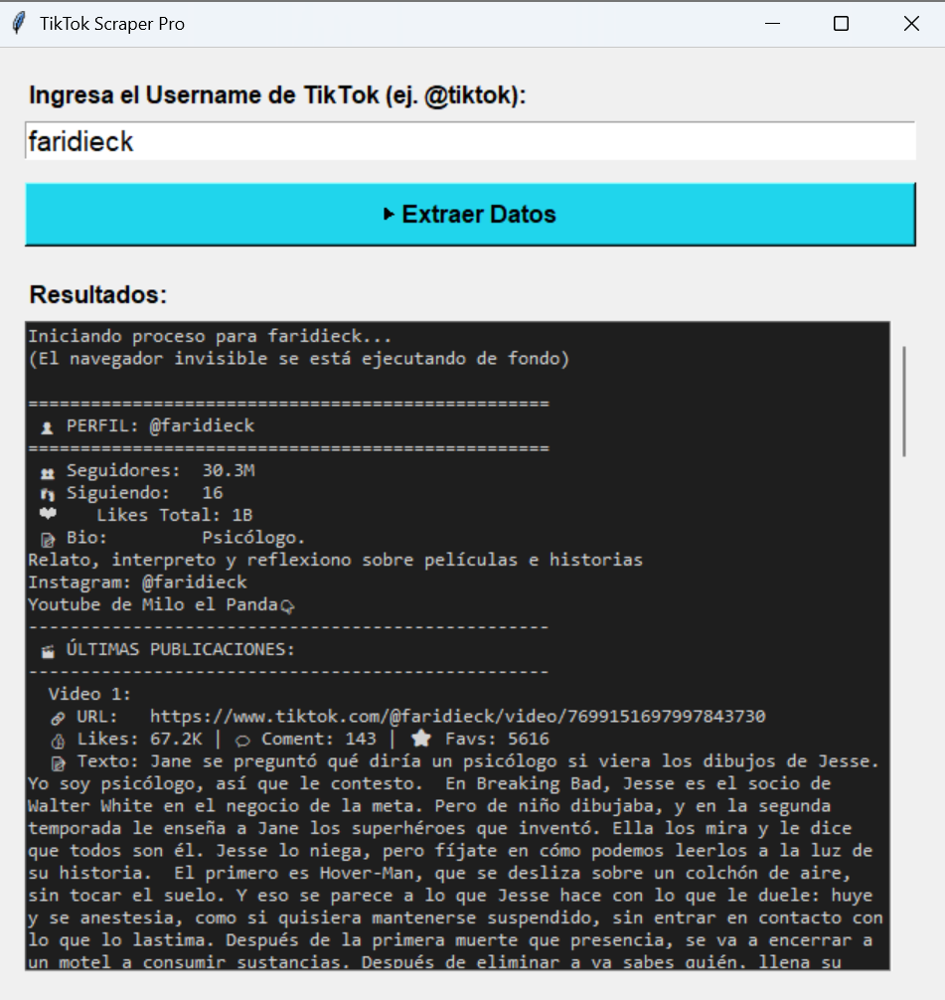

## 📸 Resumen Visual

Una mirada rápida a la herramienta en acción:

### 1. Interfaz Gráfica (Tkinter)

*Panel de control intuitivo para ingresar el usuario, gestionar cookies y visualizar el registro de eventos en tiempo real.*

### 2. Estructura de Datos (Exportación JSON)

*Consolidación automatizada de las métricas del perfil, información biográfica y el corpus de texto de las últimas publicaciones listo para el análisis NLP.*